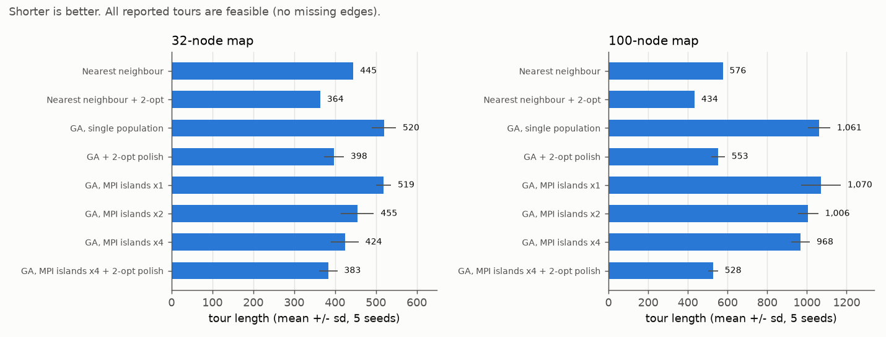
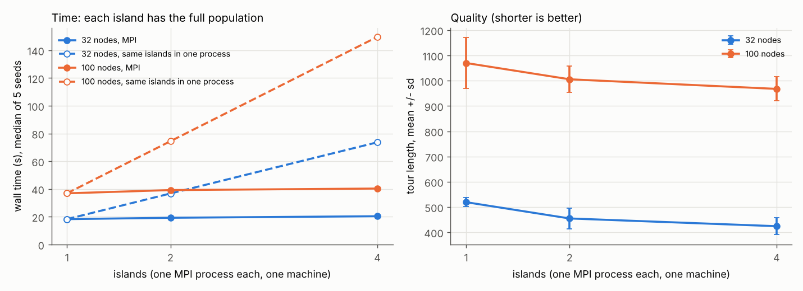

# Route optimisation with a genetic algorithm

A genetic algorithm (GA), classic baselines and an MPI island model for one delivery van that starts at a depot, visits every stop once and comes back.

Originally built for DSAI3202 Parallel & Distributed Computing, UDST, Spring 2025. Rebuilt and extended in 2026.

## In plain English

- **What it is:** a small Python package that plans the shortest round trip for one delivery van through 32 or 100 stops.
- **The problem:** every extra kilometre costs fuel and driver time, and some pairs of stops have no road between them, so a plan has to avoid those.
- **How it works:** it reads a table of distances between stops, builds many candidate routes, keeps and mixes the shorter ones for hundreds of generations (the GA), optionally runs several populations in parallel with MPI, and saves the best route with its length.
- **2025 vs 2026:** in 2025 I completed two functions of a course-provided GA and tried to parallelise it; the result crashed and, once it ran, optimised in the wrong direction. In 2026 I fixed every bug, rebuilt it as a tested package, added baselines, an MPI island model and measured experiments.
- **Main result (with the caveat):** on the 100-node map, a simple nearest neighbour + 2-opt heuristic found the shortest tour in this study (434) in well under a second; my GA alone averaged 1,061 and only reached 553 after a 2-opt polish. On the 32-node map the best tour came from 4 MPI islands + 2-opt (355). The MPI island version gave identical results to the serial version and ran 3.52x faster with 4 processes on one machine.
- **Why it matters:** last-mile delivery in Qatar and the Gulf is a routing problem at its core; this project shows I can fix broken optimisation code, measure it honestly against simple baselines and distribute it with MPI.

## The problem

A van leaves the depot (node 0), visits every other stop exactly once, and returns to the depot. The goal is the shortest total distance. This is the travelling salesman problem (TSP). Some pairs of stops have no direct road; a route that uses one of those is not allowed.

## Data

Two distance matrices provided by the course (see `data/README.md`):

| File | Stops | Missing roads (cells equal to 100000) |
|---|---:|---:|
| `data/city_distances.csv` | 32 | 192 |
| `data/city_distances_extended.csv` | 100 | 1,900 |

Both are symmetric, real distances are whole numbers from 1 to 99, and about 19 % of the pairs have no road. Where the numbers came from in the real world is unknown; they are not coordinates.

## Method

### What was 2025 and what is 2026

| Part | Year | Who |
|---|---|---|
| GA skeleton: order crossover, swap mutation, random population, trial script | 2025 | Course staff |
| `calculate_fitness` and `select_in_tournament` | 2025 | Me (following the brief) |
| Process pool for crossover and mutation (crashed) | 2025 | Me |
| Five small tests | 2025 | Me |
| Every bug fix, the `route_ga` package, baselines, island model with MPI, parallel fitness benchmark, CLI, 93 test cases, experiments, figures, CI | 2026 | Me |

About 25-30 % of the 2025 code was mine; the rest was the course skeleton. The 2025 files are kept unchanged (apart from a header saying who wrote them) in `original_2025/`.

### How the GA works, in five lines

1. Start with 200 random routes; each route is an order of the stops, with the depot fixed at both ends.
2. Score each route by its length, adding 100,000 for every missing road, so any route with fewer missing roads always wins.
3. Pick parents by small tournaments (3 routes, the shortest wins) and combine two parents with order crossover.
4. Randomly swap two stops in some children (mutation); copy the 2 best routes unchanged (elitism), so the best route can never get worse.
5. Repeat for 1,000 or 2,000 generations; if nothing improves for 150 generations, keep the best and restart the rest.

### Baselines

- **Nearest neighbour:** from the depot, always drive to the closest unvisited stop.
- **2-opt:** take a route and keep reversing any section that makes it shorter, until no reversal helps.
- **Brute force:** check every possible route; only possible for tiny maps (8 stops = 5,040 routes).

### Island model with MPI

Each MPI process runs its own GA population (an island). Every 25 generations each island sends copies of its 2 best routes to the next island in a ring, which replaces its 2 worst. A serial version runs the same islands one after another in one process; with the same seed both versions give exactly the same route, which is how I checked the MPI code is correct. All runs here are on one machine with 4 cores.

Design choices and the reason for each are in `docs/DECISIONS.md`.

## Results vs baselines

Every number below is produced by `scripts/run_experiments.py` and stored in `results/` with the seeds (0 to 4), settings, machine details and timestamps. `scripts/check_readme_claims.py` fails if this README and `results/` disagree. Machine: 4-core Intel Xeon at 2.10 GHz, Linux, Python 3.12.3, NumPy 2.5.3, Open MPI 4.1.6, mpi4py 4.1.2. "Best known" is the shortest tour any method found in this study; it is not a proven optimum. Nearest neighbour and 2-opt are deterministic, so their spread is 0. Every reported tour uses no missing road.

### 32-node map

<!-- BEGIN:map32 -->
| Method | Tour length, mean +/- sd | Best of 5 | Gap to best known | Time (s), mean +/- sd | Generations to converge |
|---|---:|---:|---:|---:|---:|
| Nearest neighbour | 445.0 +/- 0.0 | 445 | 25.4 % | 0.00 +/- 0.00 | n/a |
| Nearest neighbour + 2-opt | 364.0 +/- 0.0 | 364 | 2.5 % | 0.00 +/- 0.00 | n/a |
| GA, single population | 519.6 +/- 29.6 | 493 | 46.4 % | 9.86 +/- 0.11 | 668 +/- 280 |
| GA + 2-opt polish | 397.6 +/- 24.1 | 370 | 12.0 % | 9.87 +/- 0.10 | n/a |
| GA, MPI islands x1 | 519.2 +/- 17.9 | 503 | 46.3 % | 9.91 +/- 0.20 | 578 +/- 245 |
| GA, MPI islands x2 | 454.8 +/- 40.4 | 390 | 28.1 % | 10.53 +/- 0.23 | 555 +/- 276 |
| GA, MPI islands x4 | 424.2 +/- 33.6 | 367 | 19.5 % | 10.97 +/- 0.27 | 562 +/- 227 |
| GA, MPI islands x4 + 2-opt polish | 383.4 +/- 22.5 | 355 | 8.0 % | 10.97 +/- 0.27 | n/a |
<!-- END:map32 -->



### 100-node map

<!-- BEGIN:map100 -->
| Method | Tour length, mean +/- sd | Best of 5 | Gap to best known | Time (s), mean +/- sd | Generations to converge |
|---|---:|---:|---:|---:|---:|
| Nearest neighbour | 576.0 +/- 0.0 | 576 | 32.7 % | 0.00 +/- 0.00 | n/a |
| Nearest neighbour + 2-opt | 434.0 +/- 0.0 | 434 | 0.0 % | 0.00 +/- 0.00 | n/a |
| GA, single population | 1,061.2 +/- 56.0 | 999 | 144.5 % | 19.76 +/- 0.29 | 1,735 +/- 193 |
| GA + 2-opt polish | 552.6 +/- 33.8 | 512 | 27.3 % | 19.77 +/- 0.29 | n/a |
| GA, MPI islands x1 | 1,070.0 +/- 100.6 | 925 | 146.5 % | 20.81 +/- 0.76 | 1,605 +/- 342 |
| GA, MPI islands x2 | 1,005.6 +/- 51.7 | 924 | 131.7 % | 21.56 +/- 0.20 | 1,578 +/- 380 |
| GA, MPI islands x4 | 967.6 +/- 47.5 | 910 | 122.9 % | 22.70 +/- 1.16 | 1,843 +/- 83 |
| GA, MPI islands x4 + 2-opt polish | 527.6 +/- 24.4 | 498 | 21.6 % | 22.71 +/- 1.16 | n/a |
<!-- END:map100 -->


### What these numbers say

- **2-opt beats my GA.** On the 100-node map, nearest neighbour + 2-opt (434) is shorter than every GA variant, even after polishing the GA result with 2-opt (553 on average, 528 for 4 islands + 2-opt), and it takes a fraction of a second instead of 20 s. On the 32-node map nearest neighbour + 2-opt (364) also beats the GA alone (520) and the GA + 2-opt polish (398). Only 4 islands + 2-opt polish found a shorter tour on 32 nodes than 2-opt alone (355 at best, 383 on average).
- **Why:** swap mutation and order crossover move stops around without looking at distances, so most children are worse than their parents. 2-opt removes crossing edges directly, and for symmetric maps that is the move that matters. The GA would need a smarter mutation (for example a 2-opt move) or local search inside the loop to compete.
- **More islands help quality.** With the same population per island, 4 islands beat 1 island on both maps (424 vs 519 on 32 nodes, 968 vs 1,070 on 100 nodes), because migration shares good routes between populations that explore differently.

### Correctness anchor: 8-stop maps with a known optimum

100 random 8-stop maps (20 per seed, about 19 % missing roads, like the course maps), each solved exactly by brute force.

<!-- BEGIN:anchor -->
| Method | Found the exact optimum | Hit rate per seed, mean +/- sd | Tours using a missing edge | Mean gap to optimum, feasible tours only |
|---|---:|---:|---:|---:|
| Nearest neighbour | 12 of 100 | 12 % +/- 3 % | 38 of 100 | 15.1 % |
| Nearest neighbour + 2-opt | 68 of 100 | 68 % +/- 9 % | 0 of 100 | 2.8 % |
| GA, single population | 62 of 100 | 62 % +/- 14 % | 0 of 100 | 4.2 % |
<!-- END:anchor -->

The GA here had a population of 50 for 100 generations, so it scored about as many routes (5,000) as brute force checks (5,040) and still missed the optimum on 38 of the 100 maps. Nearest neighbour + 2-opt found the optimum more often (68 of 100) and far faster.

### MPI islands: time and quality on one machine

Each island keeps the full population of 200, so 4 islands do 4 times the work. "Same islands run serially" runs identical islands in one process; the routes are identical, so the speed-up compares the same computation.

<!-- BEGIN:islands32 -->
| Islands (MPI processes) | Tour length, mean +/- sd | MPI time (s) | Same islands run serially (s) | Speed-up | Same result as serial? |
|---:|---:|---:|---:|---:|---|
| 1 | 519.2 +/- 17.9 | 9.91 +/- 0.20 | n/a | 1.00x (reference) | n/a |
| 2 | 454.8 +/- 40.4 | 10.53 +/- 0.23 | 20.09 +/- 0.61 | 1.91x | yes, 5 of 5 seeds |
| 4 | 424.2 +/- 33.6 | 10.97 +/- 0.27 | 39.58 +/- 0.59 | 3.61x | yes, 5 of 5 seeds |
<!-- END:islands32 -->

<!-- BEGIN:islands100 -->
| Islands (MPI processes) | Tour length, mean +/- sd | MPI time (s) | Same islands run serially (s) | Speed-up | Same result as serial? |
|---:|---:|---:|---:|---:|---|
| 1 | 1,070.0 +/- 100.6 | 20.81 +/- 0.76 | n/a | 1.00x (reference) | n/a |
| 2 | 1,005.6 +/- 51.7 | 21.56 +/- 0.20 | 40.38 +/- 0.32 | 1.87x | yes, 5 of 5 seeds |
| 4 | 967.6 +/- 47.5 | 22.70 +/- 1.16 | 79.80 +/- 0.93 | 3.52x | yes, 5 of 5 seeds |
<!-- END:islands100 -->



With 4 MPI processes on 4 cores the 4-island run took about the same time as one island, 3.52x faster than running the same islands one after another on the 100-node map (3.61x on 32 nodes). The small rise in MPI time from 1 to 4 islands is migration plus the processes sharing the machine.

### Parallel fitness evaluation: when is a process pool worth it?

Time to score one population on the 100-node map (median of 3 repeats, mean +/- sd over 5 seeds, pool started beforehand with the `spawn` method, 4 workers). Pool results were checked equal to the sequential ones.

<!-- BEGIN:fitness -->
| Population | Python loop, 1 process (ms) | Python loop, 4-process pool (ms) | NumPy, 1 process (ms) | NumPy, 4-process pool (ms) | Whole GA generation (ms) |
|---:|---:|---:|---:|---:|---:|
| 500 | 2.8 +/- 0.3 | 3.5 +/- 1.5 | 0.3 +/- 0.0 | 2.4 +/- 1.6 | 26.2 +/- 6.9 |
| 2,000 | 13.2 +/- 3.4 | 7.7 +/- 1.8 | 1.3 +/- 0.1 | 4.1 +/- 0.6 | 106.6 +/- 10.6 |
| 10,000 | 62.6 +/- 11.8 | 42.1 +/- 7.8 | 7.0 +/- 0.3 | 22.9 +/- 9.1 | 503.2 +/- 15.7 |
<!-- END:fitness -->

- A 4-process pool only helps the slow plain-Python loop, and only from about 2,000 routes up.
- Vectorised NumPy in one process beats the pool at every size; at 10,000 routes the Python-loop pool is 6 times slower than NumPy in one process.
- Scoring is a small part of a GA generation (7.0 ms of about 503 ms at 10,000 routes); breeding children dominates. So the parallel fitness step that the 2025 brief asked for is not where the time goes. Running whole islands in parallel with MPI is.

### Best route found


The map layout is made from the road distances with multidimensional scaling (MDS). It is only for display; the stops have no real coordinates. The 100-node version is `figures/best_route_100.png`.

### Parameter tuning

Tournament size and mutation rate were picked on the 32-node map with 3 extra seeds (100, 101, 102) that are not used in any result above, 500 generations each:

<!-- BEGIN:tuning -->
| Tournament size | Mutation rate | Cost, mean +/- sd (3 tuning seeds) |
|---:|---:|---:|
| 2 | 0.1 | 575.0 +/- 54.0 |
| 2 | 0.3 | 719.3 +/- 18.6 |
| 2 | 0.6 | 808.7 +/- 60.9 |
| 2 | 0.9 | 770.7 +/- 80.3 |
| 3 | 0.1 | 591.3 +/- 35.9 |
| 3 | 0.3 | 517.0 +/- 29.1 |
| 3 | 0.6 | 592.0 +/- 41.5 |
| 3 | 0.9 | 691.0 +/- 62.6 |
| 5 | 0.1 | 563.0 +/- 12.2 |
| 5 | 0.3 | 572.0 +/- 70.5 |
| 5 | 0.6 | 531.0 +/- 33.9 |
| 5 | 0.9 | 562.0 +/- 30.5 |
<!-- END:tuning -->

## What went wrong in 2025 and how I fixed it

I confirmed each bug by running the 2025 code before rebuilding (details in `original_2025/README.md`). Each one has a regression test in `tests/test_regressions_2025.py` that runs the 2025 code (expected to fail, shown as XFAIL) and the new code (must pass).

| 2025 bug | What happened | Fix |
|---|---|---|
| Wrong direction | Fitness was negative distance, but the loop took the minimum and replaced the best routes. With the pool removed, the route it called "best" went from 1,300,840 to 1,400,983 over 60 generations, and the shortest route in the population went from 101,498 to 201,175. | Minimise a positive cost everywhere; elitism; a test that the best never gets worse. |
| PicklingError | Lambdas were sent to a process pool, so the script crashed at the first crossover. | Module-level worker functions, a `spawn` pool, tests run under `spawn`. |
| Missing roads not penalised | The code checked for 10000; the data uses 100000, so the penalty never fired. | Any cell >= 100000 is a missing road and costs 100,000. |
| Route not closed | The return to the depot was never counted. | Tours are always `[0, ..., 0]`; length includes the return leg. |
| Result only printed | The final print sat outside the loop and nothing was saved. | Every run writes JSON with the tour, length, history, seed and machine details. |
| Only ran from `src/` | Data path was relative to the working directory. | Paths relative to the package; runs from anywhere. |
| No `__main__` guard | Under `spawn` (Windows, macOS) the workers re-ran the script. | A proper CLI; CI runs on Windows too. |
| Not distributed, not timed, 100-node map unused | None of this was done. | MPI island model, timings, both maps, 5 seeds each. |

## Limitations

- One van only. Several vans with capacities (a vehicle routing problem) is not implemented.
- Distances are fixed; no traffic, time windows or delivery deadlines.
- MPI was only run on one machine with 4 cores, not on a cluster of machines, so network cost between machines is not measured.
- The matrices are course data of unknown real-world origin, so the lengths have no units.
- "Best known" is only the best tour found here. I did not prove it is the shortest possible for the 32- or 100-node maps.
- My GA uses the course operators (order crossover, swap mutation) and loses to 2-opt; I did not try stronger operators.

## What I learned

- I learned to check the direction of an optimiser first: one `min` instead of `max` made my 2025 GA keep the worst routes, and nothing crashed to warn me.
- I learned that a simple baseline has to come before the fancy method; 2-opt in a few lines beat my GA.
- I learned why lambdas cannot go to a process pool and why code must work under `spawn`.
- I learned that parallelising the wrong step does not help: scoring was cheap, breeding was the cost.
- I learned to make MPI code testable by writing a serial twin that must give the same answer.
- I learned to save every result with its seed and machine details so every number in a README can be checked.

## How to run

Python 3.12. From the repository root:

```bash
python -m venv .venv
source .venv/bin/activate          # Windows: .venv\Scripts\activate
pip install -r requirements-dev.txt
pip install -e .
```

Solve a map:

```bash
python -m route_ga --help
python -m route_ga --map 32 --method nn
python -m route_ga --map 100 --method 2opt
python -m route_ga --map 32 --method ga --seed 0 --out runs/ga32.json
python -m route_ga --map 32 --method ga --seed 0 --polish
python -m route_ga --map 32 --method ga-islands --islands 4 --seed 0
```

MPI islands (Linux; needs Open MPI, for example `sudo apt install openmpi-bin libopenmpi-dev`):

```bash
pip install -r requirements-mpi.txt
mpiexec -n 4 python -m route_ga --map 100 --method ga-islands --seed 0
```

Tests, lint, and the checks used in CI:

```bash
pytest -rx --cov=route_ga
ruff check .
python scripts/check_readme_claims.py
python scripts/pii_scan.py
```

Reproduce every result and figure (about 30 minutes on 4 cores; needs MPI):

```bash
python scripts/run_experiments.py
python scripts/make_figures.py
```

### Demo video

> **PLACEHOLDER:** a short screen recording of a run will go here. Not recorded yet.

## Credits

- Assignment brief, GA skeleton (order crossover, swap mutation, population generator, trial script) and both distance matrices: DSAI3202 course staff, UDST, Spring 2025. Their files are marked in `original_2025/` and `data/README.md`.
- Libraries: NumPy, Matplotlib, mpi4py, Open MPI, pytest, Hypothesis, Ruff.

## Licence

MIT for my code (see `LICENSE`). The course-provided data and 2025 skeleton files are included for reference and are not relicensed.
