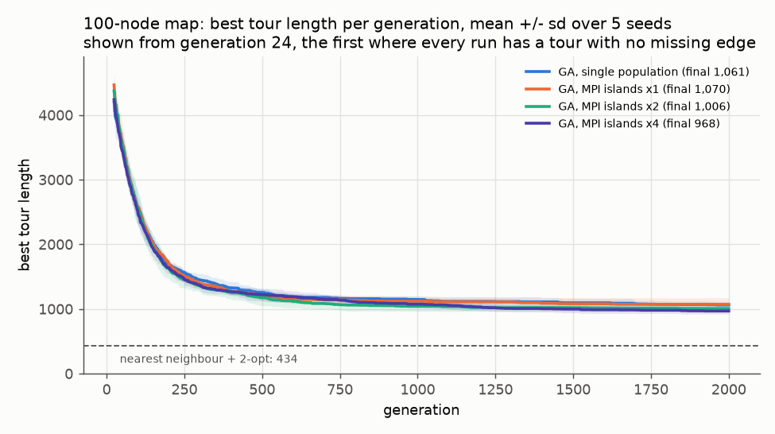
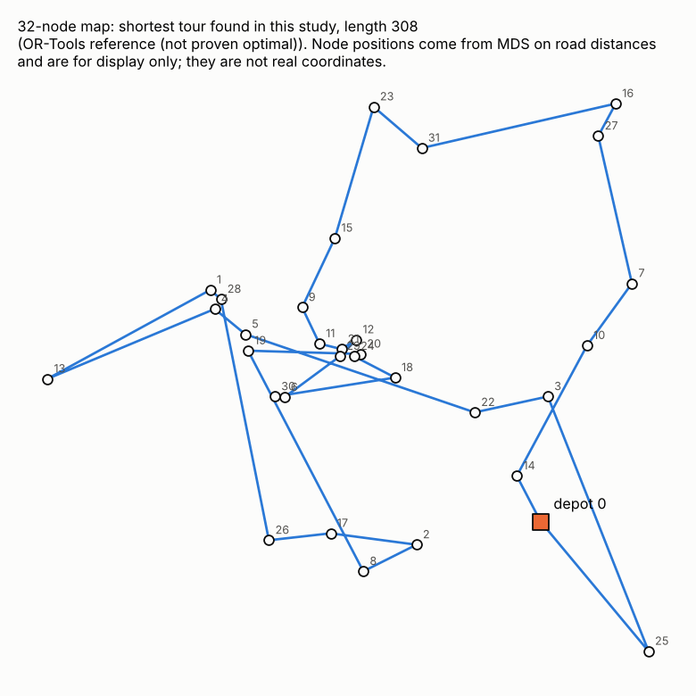

# Route optimisation with a genetic algorithm

A genetic algorithm (GA), classic baselines and an MPI island model for one delivery van that starts at a depot, visits every stop once and comes back.

Originally built for DSAI3202 Parallel & Distributed Computing, UDST, Spring 2025. Rebuilt and extended in 2026.

## In plain English

- **What it is:** a small Python package that plans the shortest round trip for one delivery van through 32 or 100 stops.
- **The problem:** every extra kilometre costs fuel and driver time, and some pairs of stops have no road between them, so a plan has to avoid those.
- **How it works:** it reads a table of distances between stops, builds many candidate routes, keeps and mixes the shorter ones for 1,000 to 2,000 generations (the GA), can run several populations in parallel with MPI, and saves the best route with its length to a JSON file.
- **2025 vs 2026:** in 2025 I completed two functions of a course-provided GA and tried to parallelise it; it crashed and, once it ran, kept the worst routes. In 2026 I fixed every bug, rebuilt it as a tested package, and added baselines, an MPI island model, a reference solver and measured experiments.
- **Main result (with the caveat):** my GA is not competitive. On the 100-node map it averaged 1,061, simple nearest neighbour + 2-opt found 434, and the OR-Tools reference solver found 338. What does work is the MPI version: identical routes to the serial version, 3.38 times faster with 4 MPI processes on one 4-core machine.
- **Why it matters:** last-mile delivery in Qatar and the Gulf is a routing problem at its core; this project shows I can fix broken optimisation code, measure it honestly against baselines and distribute it with MPI.

## The problem

A van leaves the depot (node 0), visits every other stop exactly once, and returns to the depot. The goal is the shortest total distance. This is the travelling salesman problem (TSP). Some pairs of stops have no direct road; a route that uses one of those is not allowed.

## Data

Two distance matrices provided by the course (see `data/README.md`):

| File | Stops | Missing roads (cells equal to 100000) |
|---|---:|---:|
| `data/city_distances.csv` | 32 | 192 |
| `data/city_distances_extended.csv` | 100 | 1,900 |

Both are symmetric, real distances are whole numbers from 1 to 99, and about 19 % of the pairs have no road. Where the numbers came from in the real world is unknown; they are not coordinates.

## Method

### What was 2025 and what is 2026

| Part | Year | Who |
|---|---|---|
| GA skeleton: order crossover, swap mutation, random population, trial script | 2025 | Course staff |
| `calculate_fitness` and `select_in_tournament` | 2025 | Me (following the brief) |
| Process pool for crossover and mutation (crashed) | 2025 | Me |
| Five small tests | 2025 | Me |
| Every bug fix, the `route_ga` package, baselines, OR-Tools reference, island model with MPI, parallel fitness benchmark, CLI, 96 test cases, experiments, figures, CI | 2026 | Me |

About 25-30 % of the 2025 code was mine; the rest was the course skeleton. The 2025 files are kept unchanged (apart from a header saying who wrote them) in `original_2025/`.

### How the GA works, in five lines

1. Start with 200 random routes; each route is an order of the stops, with the depot fixed at both ends.
2. Score each route by its length, adding 100,000 for every missing road, so any route with fewer missing roads always wins.
3. Pick parents by small tournaments (3 routes, the shortest wins) and combine two parents with order crossover.
4. Randomly swap two stops in some children (mutation); copy the 2 best routes unchanged (elitism), so the best route can never get worse.
5. Repeat for 1,000 or 2,000 generations; if nothing improves for 150 generations, keep the best and restart the rest.

### Baselines and reference

- **Nearest neighbour:** from the depot, always drive to the closest unvisited stop.
- **2-opt:** take a route and keep reversing any section that makes it shorter, until no reversal helps.
- **Brute force:** check every possible route; only possible for tiny maps (8 stops = 5,040 routes).
- **OR-Tools reference:** Google OR-Tools routing (guided local search) with a 30-second limit. It is a reference solver, not proven optimal.

### Island model with MPI

Each MPI process runs its own GA population (an island). Every 25 generations each island sends copies of its 2 best routes to the next island in a ring, which replaces its 2 worst. A serial version runs the same islands one after another in one process; with the same seed both versions give exactly the same route, which is how I checked the MPI code is correct. All runs here are on one machine.

Design choices and the reason for each are in `docs/DECISIONS.md`.

## Results vs baselines

Every number below comes from `scripts/run_experiments.py` and is stored in `results/` with the seeds (0 to 4), settings, machine details, timestamp and the git commit of `src/`. `scripts/check_readme_claims.py` fails if any number in this README is not in `results/`, or if the results were not made from the current code. Machine: Intel(R) Xeon(R) Processor @ 2.10GHz, 4 cores, Linux, Python 3.12.3, NumPy 2.5.3, Open MPI 4.1.6, mpi4py 4.1.2, OR-Tools 9.15.6755. It is a shared cloud VM, so timings can vary between runs; every time is a median with the interquartile range (IQR) over at least 5 runs. "Best found" is the shortest tour any method found in this study; it is not a proven optimum. Nearest neighbour and 2-opt are deterministic, so their spread is 0. Every reported tour uses no missing road.

<!-- BEGIN:bestfound -->
| Map | Shortest tour found in this study | Found by | Results file |
|---:|---:|---|---|
| 32 nodes | 308 | OR-Tools reference (not proven optimal) | `results/reference_ortools.json` |
| 100 nodes | 338 | OR-Tools reference (not proven optimal) | `results/reference_ortools.json` |
<!-- END:bestfound -->

### 32-node map

<!-- BEGIN:map32 -->
| Method | Tour length, mean +/- sd | Best of 5 | Gap to best found | Gap to OR-Tools | Time (s), median [IQR] | Generations to converge |
|---|---:|---:|---:|---:|---:|---:|
| Nearest neighbour | 445.0 +/- 0.0 | 445 | 44.5 % | 44.5 % | 0.00 [0.00-0.00] | n/a |
| Nearest neighbour + 2-opt | 364.0 +/- 0.0 | 364 | 18.2 % | 18.2 % | 0.00 [0.00-0.00] | n/a |
| GA, single population | 519.6 +/- 29.6 | 493 | 68.7 % | 68.7 % | 8.15 [8.04-8.16] | 668 +/- 280 |
| GA + 2-opt polish | 397.6 +/- 24.1 | 370 | 29.1 % | 29.1 % | 8.15 [8.04-8.16] | n/a |
| GA, MPI islands x1 | 519.2 +/- 17.9 | 503 | 68.6 % | 68.6 % | 8.45 [7.82-8.46] | 578 +/- 245 |
| GA, MPI islands x2 | 454.8 +/- 40.4 | 390 | 47.7 % | 47.7 % | 8.88 [8.87-8.88] | 555 +/- 276 |
| GA, MPI islands x4 | 424.2 +/- 33.6 | 367 | 37.7 % | 37.7 % | 9.55 [9.47-9.73] | 562 +/- 227 |
| GA, MPI islands x4 + 2-opt polish | 383.4 +/- 22.5 | 355 | 24.5 % | 24.5 % | 9.55 [9.47-9.73] | n/a |
| OR-Tools reference (not proven optimal) | 308.0 +/- 0.0 (5 repeats) | 308 | 0.0 % | 0.0 % | 30 (time limit) | n/a |
<!-- END:map32 -->


### 100-node map

<!-- BEGIN:map100 -->
| Method | Tour length, mean +/- sd | Best of 5 | Gap to best found | Gap to OR-Tools | Time (s), median [IQR] | Generations to converge |
|---|---:|---:|---:|---:|---:|---:|
| Nearest neighbour | 576.0 +/- 0.0 | 576 | 70.4 % | 70.4 % | 0.00 [0.00-0.00] | n/a |
| Nearest neighbour + 2-opt | 434.0 +/- 0.0 | 434 | 28.4 % | 28.4 % | 0.00 [0.00-0.00] | n/a |
| GA, single population | 1,061.2 +/- 56.0 | 999 | 214.0 % | 214.0 % | 17.05 [16.45-17.13] | 1,735 +/- 193 |
| GA + 2-opt polish | 552.6 +/- 33.8 | 512 | 63.5 % | 63.5 % | 17.06 [16.46-17.14] | n/a |
| GA, MPI islands x1 | 1,070.0 +/- 100.6 | 925 | 216.6 % | 216.6 % | 16.90 [16.09-17.03] | 1,605 +/- 342 |
| GA, MPI islands x2 | 1,005.6 +/- 51.7 | 924 | 197.5 % | 197.5 % | 18.52 [18.38-18.82] | 1,578 +/- 380 |
| GA, MPI islands x4 | 967.6 +/- 47.5 | 910 | 186.3 % | 186.3 % | 19.84 [19.70-20.24] | 1,843 +/- 83 |
| GA, MPI islands x4 + 2-opt polish | 527.6 +/- 24.4 | 498 | 56.1 % | 56.1 % | 19.84 [19.71-20.24] | n/a |
| OR-Tools reference (not proven optimal) | 338.0 +/- 0.0 (5 repeats) | 338 | 0.0 % | 0.0 % | 30 (time limit) | n/a |
<!-- END:map100 -->



### What these numbers say

- **My GA loses, and so does 2-opt, to the reference.** On the 100-node map the GA alone averaged 1,061, the GA + 2-opt polish 553 and 4 islands + 2-opt 528. Nearest neighbour + 2-opt found 434 in well under a second, and OR-Tools found 338 (434 is 28.4 % longer). On the 32-node map it is the same order: GA 520, GA + 2-opt 398, nearest neighbour + 2-opt 364, OR-Tools 308.
- **Why:** swap mutation and order crossover move stops around without looking at distances, so most children are worse than their parents. 2-opt removes crossing edges directly, and OR-Tools combines that kind of move with a smarter search. The GA would need distance-aware operators or local search inside the loop to compete.
- **More islands help quality.** With the same population per island, 4 islands beat 1 island on both maps (424 vs 519 on 32 nodes, 968 vs 1,070 on 100 nodes), because migration shares good routes between populations that explore differently.

### Correctness anchor: 8-stop maps with a known optimum

100 random 8-stop maps (20 per seed, about 19 % missing roads, like the course maps), each solved exactly by brute force.

<!-- BEGIN:anchor -->
| Method | Found the exact optimum | Hit rate per seed, mean +/- sd | Tours using a missing edge | Mean gap to optimum, feasible tours only |
|---|---:|---:|---:|---:|
| Nearest neighbour | 12 of 100 | 12 % +/- 3 % | 38 of 100 | 15.1 % |
| Nearest neighbour + 2-opt | 68 of 100 | 68 % +/- 9 % | 0 of 100 | 2.8 % |
| GA, single population | 62 of 100 | 62 % +/- 14 % | 0 of 100 | 4.2 % |
<!-- END:anchor -->

The GA here had a population of 50 for 100 generations, so it scored about as many routes (5,000) as brute force checks (5,040) and still missed the optimum on 38 of the 100 maps. Nearest neighbour + 2-opt found it more often (68 of 100) and far faster.

### MPI islands: time and quality on one machine

Each island keeps the full population of 200, so 4 islands do 4 times the work. "One after another" runs the identical islands in one process; the routes are identical, so the speed-up compares the same computation.

<!-- BEGIN:islands32 -->
| Islands (MPI processes) | Tour length, mean +/- sd | MPI time (s), median [IQR] | Same islands one after another (s), median [IQR] | Speed-up | Same result? |
|---:|---:|---:|---:|---:|---|
| 1 | 519.2 +/- 17.9 | 8.45 [7.82-8.46] | n/a | n/a (one island) | n/a |
| 2 | 454.8 +/- 40.4 | 8.88 [8.87-8.88] | 16.50 [16.46-16.85] | 1.86 times faster | yes, 5 of 5 seeds |
| 4 | 424.2 +/- 33.6 | 9.55 [9.47-9.73] | 32.51 [31.65-32.99] | 3.41 times faster | yes, 5 of 5 seeds |
<!-- END:islands32 -->

<!-- BEGIN:islands100 -->
| Islands (MPI processes) | Tour length, mean +/- sd | MPI time (s), median [IQR] | Same islands one after another (s), median [IQR] | Speed-up | Same result? |
|---:|---:|---:|---:|---:|---|
| 1 | 1,070.0 +/- 100.6 | 16.90 [16.09-17.03] | n/a | n/a (one island) | n/a |
| 2 | 1,005.6 +/- 51.7 | 18.52 [18.38-18.82] | 34.40 [33.71-34.42] | 1.86 times faster | yes, 5 of 5 seeds |
| 4 | 967.6 +/- 47.5 | 19.84 [19.70-20.24] | 67.07 [65.74-67.64] | 3.38 times faster | yes, 5 of 5 seeds |
<!-- END:islands100 -->


On the 100-node map the 4 islands ran 3.38 times faster with 4 MPI processes on one 4-core machine, compared with the same 4 islands run one after another (3.41 times faster on the 32-node map). The small rise in MPI time from 1 to 4 islands is migration plus 4 processes sharing the machine.

Each island has a full population, so N islands score about N times as many routes as one population (counted from the saved runs; 2-opt polish not included):

<!-- BEGIN:evaluations -->
| Map | Method | Fitness evaluations per run, mean | Times the single GA | Tour length, mean |
|---:|---|---:|---:|---:|
| 32 | GA, single population | 201,000 | 1.00 | 519.6 |
| 32 | GA, MPI islands x1 | 200,920 | 1.00 | 519.2 |
| 32 | GA, MPI islands x2 | 402,320 | 2.00 | 454.8 |
| 32 | GA, MPI islands x4 | 803,880 | 4.00 | 424.2 |
| 100 | GA, single population | 401,400 | 1.00 | 1,061.2 |
| 100 | GA, MPI islands x1 | 401,440 | 1.00 | 1,070.0 |
| 100 | GA, MPI islands x2 | 802,960 | 2.00 | 1,005.6 |
| 100 | GA, MPI islands x4 | 1,603,960 | 4.00 | 967.6 |
<!-- END:evaluations -->

So the better tours with more islands come mostly from more total work, not from parallelism itself; what MPI adds is doing that extra work in about the same wall time.

### Parallel fitness evaluation: when is a process pool worth it?

Time to score one population on the 100-node map: median [IQR] over 5 repeats for each of 5 seeds, with the pool started beforehand (`spawn` method, 4 workers). Pool results were checked equal to the sequential ones.

<!-- BEGIN:fitness -->
| Population | Python loop, 1 process (ms) | Python loop, 4-process pool (ms) | NumPy, 1 process (ms) | NumPy, 4-process pool (ms) | Whole GA generation (ms) |
|---:|---:|---:|---:|---:|---:|
| 500 | 2.5 [2.4-2.7] | 2.6 [2.3-3.4] | 0.2 [0.2-0.3] | 2.1 [1.9-3.6] | 20.0 [19.5-21.0] |
| 2,000 | 10.0 [9.6-10.5] | 7.5 [6.4-8.4] | 1.2 [1.2-1.4] | 4.2 [3.8-4.7] | 80.2 [71.4-93.5] |
| 10,000 | 52.1 [50.3-54.6] | 38.3 [31.3-44.7] | 7.4 [6.1-8.6] | 15.2 [14.4-23.4] | 413.1 [395.2-440.0] |
<!-- END:fitness -->

- A 4-process pool only helps the slow plain-Python loop, and only from about 2,000 routes up.
- Vectorised NumPy in one process beats the pool at every size; at 10,000 routes the Python-loop pool is 5 times slower than NumPy in one process.
- Scoring is a small part of a GA generation (7.4 ms of 413.1 ms at 10,000 routes); breeding children dominates. So the parallel fitness step the 2025 brief asked for is not where the time goes. Running whole islands in parallel with MPI is.

### Best route found



The map layout is made from the road distances with multidimensional scaling (MDS). It is only for display; the stops have no real coordinates. The 100-node version is `figures/best_route_100.png`.

### A shorter GA tour from a shorter run

During development a quick 40-generation smoke run (migration every 10 generations) found a 32-node tour of 334 with 4 islands + 2-opt, shorter than the best of the full 1,000-generation runs (355). I re-ran that exact configuration so the number is backed by `results/map32_quick40.json`:

<!-- BEGIN:quick40 -->
| Method (40 generations, migration every 10) | Tour length, mean +/- sd | Best of 5 |
|---|---:|---:|
| GA + 2-opt polish | 417.8 +/- 30.4 | 368 |
| GA, MPI islands x4 + 2-opt polish | 373.8 +/- 31.1 | 334 |
<!-- END:quick40 -->

2-opt polish does most of the work and the GA's swap mutation adds little: going from 40 to 1,000 generations moved the single GA's own average a long way (805.6 to 519.6), but its 2-opt-polished average only from 417.8 to 397.6 (`results/map32_quick40.json`, `results/map32.json`). A less converged population also gives 2-opt more varied starting tours, which is how the 40-generation run found 334. It is still well behind OR-Tools (308).

### Parameter tuning

Tournament size and mutation rate were checked on the 32-node map with 3 extra seeds (100, 101, 102) that are not used in any result above, 500 generations each. I had already set tournament 3 and mutation 0.3 before running the grid, and the grid picked the same pair:

<!-- BEGIN:tuning -->
| Tournament size | Mutation rate | Cost, mean +/- sd (3 tuning seeds) |
|---:|---:|---:|
| 2 | 0.1 | 575.0 +/- 54.0 |
| 2 | 0.3 | 719.3 +/- 18.6 |
| 2 | 0.6 | 808.7 +/- 60.9 |
| 2 | 0.9 | 770.7 +/- 80.3 |
| 3 | 0.1 | 591.3 +/- 35.9 |
| 3 | 0.3 | 517.0 +/- 29.1 |
| 3 | 0.6 | 592.0 +/- 41.5 |
| 3 | 0.9 | 691.0 +/- 62.6 |
| 5 | 0.1 | 563.0 +/- 12.2 |
| 5 | 0.3 | 572.0 +/- 70.5 |
| 5 | 0.6 | 531.0 +/- 33.9 |
| 5 | 0.9 | 562.0 +/- 30.5 |
<!-- END:tuning -->

## What went wrong in 2025 and how I fixed it

I confirmed each bug by running the 2025 code (`scripts/phase0_check.py`, saved in `results/phase0_2025.json`). The first six bugs below are each pinned by a regression test in `tests/test_regressions_2025.py` (7 test cases; the direction bug has two) that runs the real 2025 code and must fail with the specific exception for that bug (shown as XFAIL), and runs the new code, which must pass. The missing `__main__` guard is caught by the process-pool case on Windows and macOS, where the 2025 script breaks before it reaches the lambdas.

| 2025 bug | What happened | Fix |
|---|---|---|
| Wrong direction | Fitness was negative distance, but the loop took the minimum and replaced the best routes. With the pool removed, the route it called "best" went from 1,300,840 to 1,400,983 over 60 generations, and the shortest route in the population went from 101,498 to 201,175. | Minimise a positive cost everywhere; elitism; a test that the best never gets worse. |
| PicklingError | Lambdas were sent to a process pool, so the script crashed at the first crossover. | Module-level worker functions, a `spawn` pool, tests run under `spawn`. |
| Missing roads not penalised | The code checked for 10000; the data uses 100000, so the penalty never fired. | Any cell >= 100000 is a missing road and costs 100,000. |
| Route not closed | The return to the depot was never counted. | Tours are always `[0, ..., 0]`; length includes the return leg. |
| Result only printed | The final print sat outside the loop and nothing was saved. | Every run writes JSON with the tour, length, history, seed and machine details. |
| Only ran from `src/` | Data path was relative to the working directory. | Paths relative to the package; runs from anywhere. |
| No `__main__` guard | Under `spawn` (Windows, macOS) the workers re-ran the script. | A proper CLI; CI runs on Windows too. |
| Not distributed, not timed, 100-node map unused | None of this was done. | MPI island model, timings, both maps, 5 seeds each. |

## Limitations

- One van only. Several vans with capacities (a vehicle routing problem) is not implemented.
- Distances are fixed; no traffic, time windows or delivery deadlines.
- MPI was only run on one machine with 4 cores, not on a cluster of machines, so network cost between machines is not measured.
- The matrices are course data of unknown real-world origin, so the lengths have no units.
- "Best found" is only the best tour found here (by OR-Tools). I did not prove it is the shortest possible for the 32- or 100-node maps.
- The GA settings were checked on the same 32-node map that the results use (with different seeds), so the 32-node GA numbers may be slightly optimistic. The 100-node map was not used for tuning.
- Timings come from a shared cloud VM and can change from run to run; the medians and IQRs show the spread I saw.
- My GA uses the course operators (order crossover, swap mutation) and loses to 2-opt and OR-Tools; I did not try stronger operators.
- The island comparison is not equal work: each island has a full population, so N islands do about N times the fitness evaluations of one. Better tours with more islands come mostly from that extra work, not from parallelism itself.

## What I learned

- I learned to check the direction of an optimiser first: one `min` instead of `max` made my 2025 GA keep the worst routes, and nothing crashed to warn me.
- I learned that a simple baseline and a strong reference have to come before the fancy method; 2-opt in a few lines and OR-Tools both beat my GA.
- I learned why lambdas cannot go to a process pool and why code must work under `spawn`.
- I learned that parallelising the wrong step does not help: scoring was cheap, breeding was the cost.
- I learned to make MPI code testable by writing a serial twin that must give the same answer.
- I learned to save every result with its seed, machine and code version so every number in a README can be checked.

## How to run

Python 3.12. From the repository root:

```bash
python -m venv .venv
source .venv/bin/activate          # Windows: .venv\Scripts\activate
pip install -r requirements-dev.txt
pip install -e .
```

Solve a map:

```bash
python -m route_ga --help
python -m route_ga --map 32 --method nn
python -m route_ga --map 100 --method 2opt
python -m route_ga --map 32 --method ga --seed 0 --out runs/ga32.json
python -m route_ga --map 32 --method ga --seed 0 --polish
python -m route_ga --map 32 --method ga-islands --islands 4 --seed 0
```

MPI islands (Linux; needs Open MPI, for example `sudo apt install openmpi-bin libopenmpi-dev`):

```bash
pip install -r requirements-mpi.txt
mpiexec -n 4 python -m route_ga --map 100 --method ga-islands --seed 0
```

Tests, lint, and the checks used in CI:

```bash
pytest -rsx --cov=route_ga
ruff check .
python scripts/check_readme_claims.py
python scripts/pii_scan.py
```

Reproduce every result and figure (about half an hour on 4 cores; needs MPI):

```bash
python scripts/run_experiments.py
python scripts/make_figures.py
python scripts/record_quality.py
```

### Demo video

> **PLACEHOLDER:** a short screen recording of a run will go here. Not recorded yet.

## Credits

- Assignment brief, GA skeleton (order crossover, swap mutation, population generator, trial script) and both distance matrices: DSAI3202 course staff, UDST, Spring 2025. Their files are marked in `original_2025/` and `data/README.md`.
- Libraries: NumPy, Matplotlib, mpi4py, Open MPI, Google OR-Tools, pytest, Hypothesis, Ruff, pandas (only for running the 2025 code).

## Licence

MIT for my code (see `LICENSE`). The course-provided data and 2025 skeleton files are included for reference and are not relicensed.
